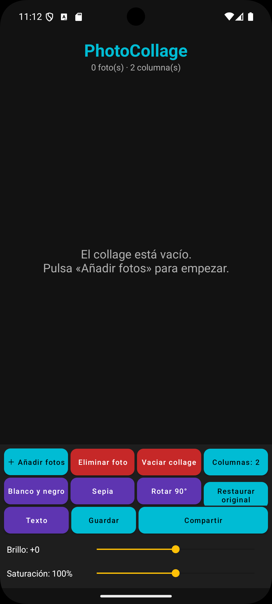
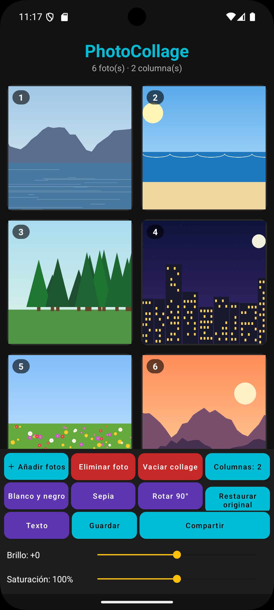
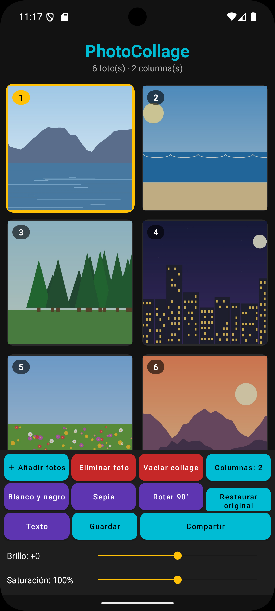
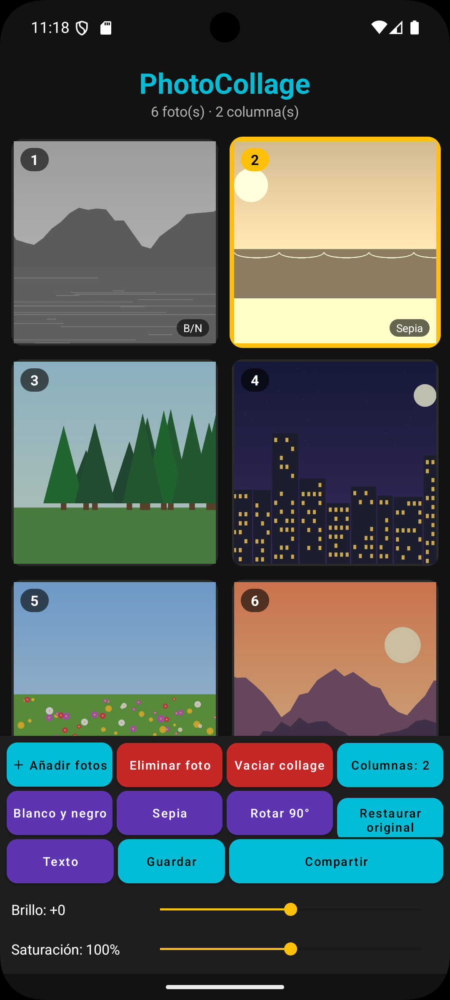
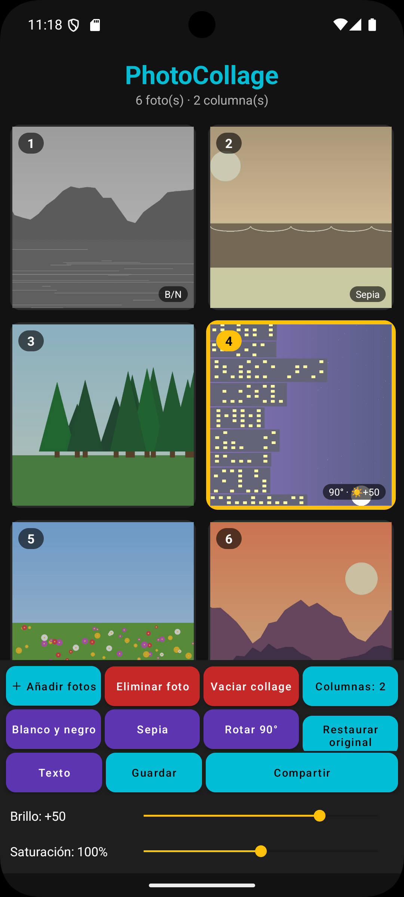
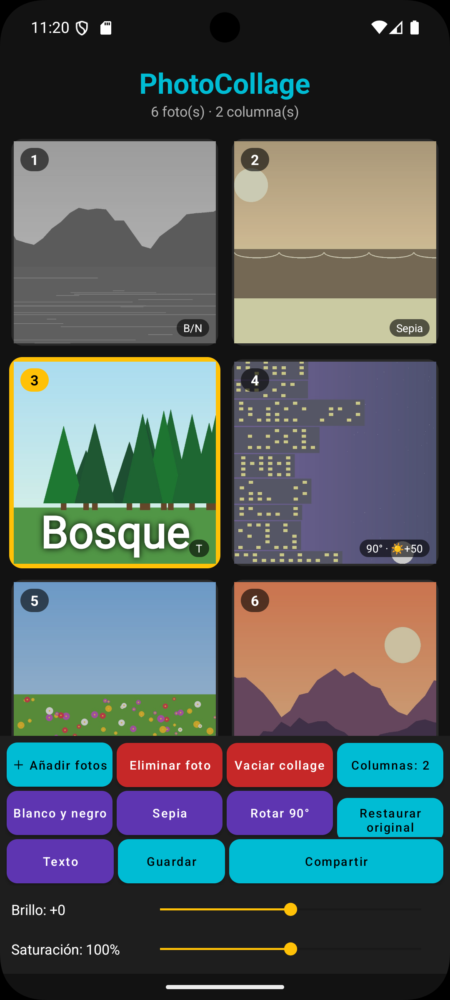
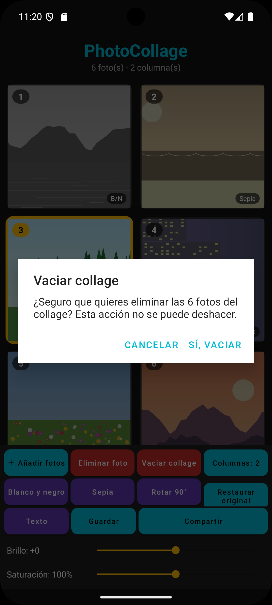
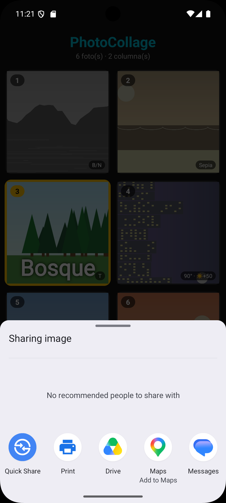
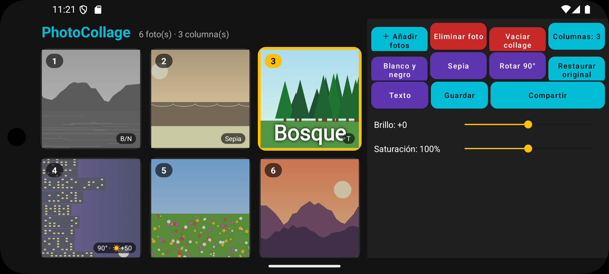

# PhotoCollage

Aplicación Android desarrollada en **Kotlin** con **Android Studio** que permite seleccionar fotografías de la galería, componer un collage en cuadrícula, editarlas (filtros, rotación, brillo, saturación y texto) y compartir o guardar la composición final.

Proyecto del examen práctico de 2.º DAM.

---

## Funcionalidades

### Requisitos obligatorios

| # | Apartado | Implementación |
|---|----------|----------------|
| 1 | **Interfaz principal** | Título *PhotoCollage*, contador de fotos, cuadrícula central y panel de controles. Hay un diseño específico para **vertical** (`layout/`) y otro para **horizontal** (`layout-land/`, controles en panel lateral). El número de columnas por defecto se adapta a la pantalla (`values/`, `values-land/`, `values-sw600dp/`). La app gestiona los insets de las barras del sistema (edge-to-edge de Android 15+). |
| 2 | **Selección de imágenes** | **Photo Picker** de Android (`PickMultipleVisualMedia`), selección múltiple, sin necesidad de permisos. Las fotos se añaden automáticamente. **No se permiten duplicados**: se comprueba la Uri y además una *huella* de los píxeles, por si la misma foto llega con otra Uri. Si el collage está vacío se muestra un mensaje. |
| 3 | **Cuadrícula** | `RecyclerView` + `GridLayoutManager` con `ListAdapter`/`DiffUtil` (se actualiza solo lo que cambia). Celdas cuadradas 1:1 con `centerCrop`: la foto no se deforma. Cada foto lleva un **número** y una etiqueta con las ediciones aplicadas (p. ej. `Sepia · 90°`). |
| 4 | **Selección y eliminación** | Pulsar una foto la selecciona (borde amarillo, el resto se atenúa); pulsarla otra vez la deselecciona. Solo una seleccionada a la vez. *Eliminar foto* borra la seleccionada (mensaje si no hay ninguna). *Vaciar collage* pide confirmación con `AlertDialog`. |
| 5 | **Filtros** | **Blanco y negro** (escala de grises por luminancia) y **Sepia** (matriz sepia clásica), implementados en Kotlin con `ColorMatrix`. **Restaurar original** recupera la foto intacta. Mantener pulsado *Restaurar* restaura **todas** las fotos. |
| 6 | **Rotación y brillo** | *Rotar 90°* gira en sentido horario, acumulando 90° por pulsación. **SeekBar de brillo** de −100 a +100 con valor por defecto 0 (centro = brillo original), cambios en tiempo real. |
| 7 | **Compartir** | Se genera una imagen final con todas las fotos del collage (misma distribución que en pantalla) y se comparte con `Intent.ACTION_SEND` + **FileProvider**. |
| 8 | **Calidad del código** | Arquitectura con **ViewModel** (el estado sobrevive al girar la pantalla), modelo inmutable, utilidades separadas, corrutinas para el trabajo pesado y control de errores. |

### Ampliaciones voluntarias (todas implementadas)

| Ampliación | Implementación |
|------------|----------------|
| **Filtro de saturación** | SeekBar de 0 % (gris) a 200 % (colores intensos); 100 % = original. |
| **Texto sobre las fotos** | Botón *Texto*: diálogo para escribir el texto y ajustar **tamaño**, **posición horizontal** y **posición vertical**, con vista previa en directo. *Quitar texto* lo elimina. |
| **Guardar el collage** | Botón *Guardar*: guarda la composición en `Imágenes/PhotoCollage`. Android 10+ usa `MediaStore` (sin permisos); Android 7–9 pide el permiso de escritura. |
| **Cambiar distribución** | Botón *Columnas*: alterna entre 1, 2, 3 y 4 columnas. La imagen compartida/guardada usa la misma distribución. |

---

## Cómo funciona por dentro

### Conservación de la imagen original
Cada foto (`CollageImage`) guarda dos bitmaps:

- `original`: la foto tal como se cargó. **Nunca se modifica.**
- `current`: la que se muestra.

Las ediciones se guardan como parámetros (`ImageEdits`: filtro, rotación, brillo, saturación, texto). Cada vez que cambia algo, `ImageUtils.render()` genera **un bitmap nuevo a partir del original**, así los filtros no se acumulan unos sobre otros y *Restaurar* simplemente vuelve a mostrar `original`.

### Filtros en Kotlin
Todas las ediciones de color se combinan en **una sola `ColorMatrix`** (saturación → filtro → brillo), de modo que los píxeles se recorren una sola vez:

- Blanco y negro: `ColorMatrix.setSaturation(0f)`.
- Sepia:
  ```
  R' = 0.393R + 0.769G + 0.189B
  G' = 0.349R + 0.686G + 0.168B
  B' = 0.272R + 0.534G + 0.131B
  ```
- Brillo: desplazamiento sumado a R, G y B.

### Memoria
- Las fotos se cargan **reducidas** (lado máximo 1080 px, con `inSampleSize`) y con la orientación EXIF corregida.
- El render se hace en segundo plano (`Dispatchers.Default`); al mover el slider de brillo se **cancela** el render anterior de esa foto.
- La imagen del collage final tiene un tamaño máximo controlado y se libera (`recycle()`) tras compartir/guardar.
- Se capturan `OutOfMemoryError` y excepciones de lectura: la app muestra un mensaje en lugar de cerrarse.

### Estructura del proyecto

```
app/src/main/java/com/example/collageapp/
├── MainActivity.kt              Interfaz: pinta el estado y reenvía eventos
├── viewmodel/
│   └── CollageViewModel.kt      Estado (fotos, selección, columnas) y lógica de edición
├── model/
│   └── CollageImage.kt          CollageImage, ImageEdits, FilterType, TextOverlay
├── adapter/
│   └── CollageAdapter.kt        ListAdapter del RecyclerView (resaltado, numeración)
└── utils/
    ├── ImageUtils.kt            Carga de fotos, filtros, rotación, texto
    ├── CollageExporter.kt       Imagen final, FileProvider, guardar en galería
    └── Event.kt                 Mensajes de un solo uso (Toast)

app/src/main/res/
├── layout/activity_main.xml     Diseño vertical
├── layout-land/activity_main.xml Diseño horizontal
├── layout/controls_panel.xml    Panel de botones y sliders (reutilizado con <include>)
├── layout/item_collage.xml      Celda de la cuadrícula
├── layout/dialog_texto.xml      Diálogo de texto
└── xml/file_paths.xml           Rutas del FileProvider
```

### Permisos
- **Leer fotos: ninguno.** El Photo Picker concede acceso solo a las fotos elegidas por el usuario (en dispositivos antiguos se usa automáticamente `ACTION_OPEN_DOCUMENT`).
- **Guardar:** `WRITE_EXTERNAL_STORAGE` solo en Android 9 o inferior (`maxSdkVersion="28"`), solicitado en tiempo de ejecución.
- **Compartir:** `FileProvider` con permiso temporal de lectura (`FLAG_GRANT_READ_URI_PERMISSION`).

---

## Instrucciones para ejecutar

1. Clonar el repositorio:
   ```bash
   git clone https://github.com/<tu-usuario>/PhotoCollage.git
   ```
2. Abrir la carpeta en **Android Studio** (*File → Open*).
3. Esperar a que termine la sincronización de Gradle (descarga las dependencias).
4. Ejecutar en un emulador o dispositivo con **Android 7.0 (API 24) o superior** con ▶ *Run 'app'*.
5. Si el emulador no tiene fotos, arrastrar algunas imágenes a la ventana del emulador o hacer fotos con su cámara.

**Requisitos:** Android Studio reciente, JDK 17 (incluido en Android Studio), compileSdk 36, minSdk 24.

### Flujo de uso
1. Pulsar **＋ Añadir fotos** y elegir varias fotos.
2. Pulsar una foto para seleccionarla (queda con borde amarillo).
3. Aplicar **Blanco y negro** o **Sepia**, girar con **Rotar 90°**, mover los sliders de **Brillo** / **Saturación**, añadir **Texto**.
4. **Restaurar original** para deshacer todas las ediciones de esa foto.
5. **Eliminar foto** o **Vaciar collage**.
6. **Columnas** para cambiar la distribución.
7. **Compartir** o **Guardar** la composición final.

---

## Capturas de pantalla

> Las capturas están en la carpeta [`capturas/`](capturas/).

| Collage vacío | Collage con fotos | Foto seleccionada |
|:---:|:---:|:---:|
|  |  |  |

| Blanco y negro / Sepia | Rotación y brillo | Texto sobre la foto |
|:---:|:---:|:---:|
|  |  |  |

| Vaciar (AlertDialog) | Compartir | Horizontal |
|:---:|:---:|:---:|
|  |  |  |
